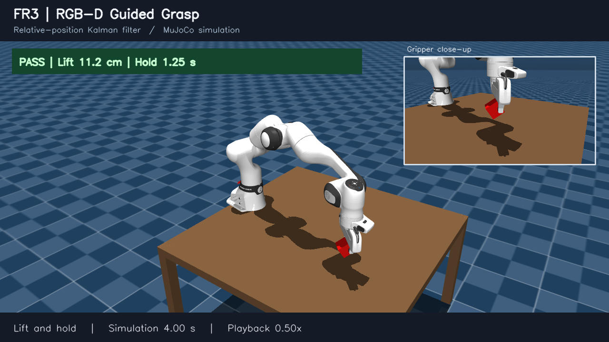
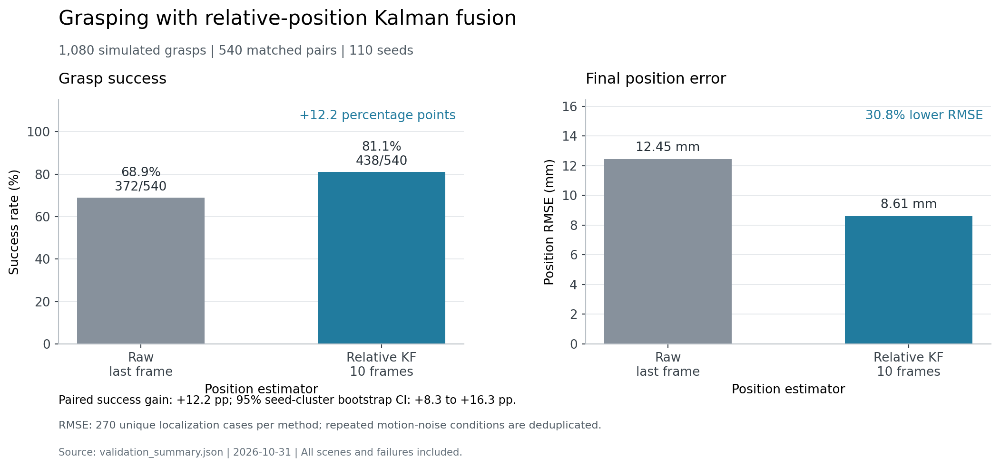
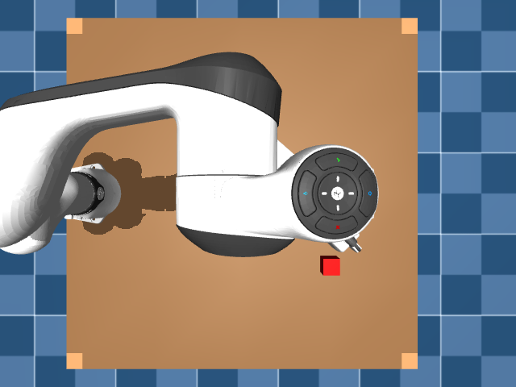
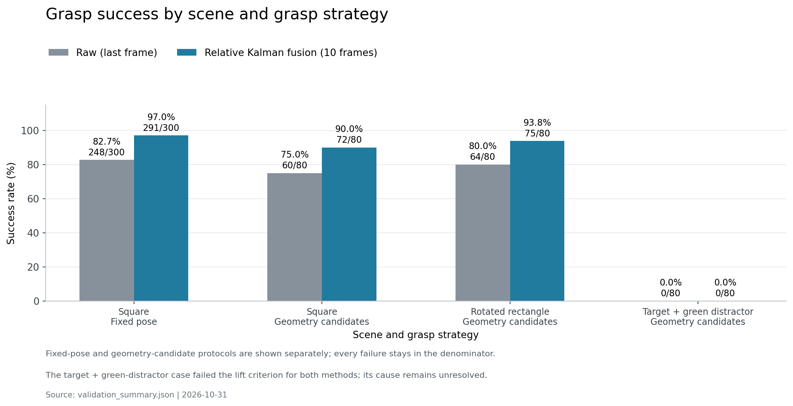
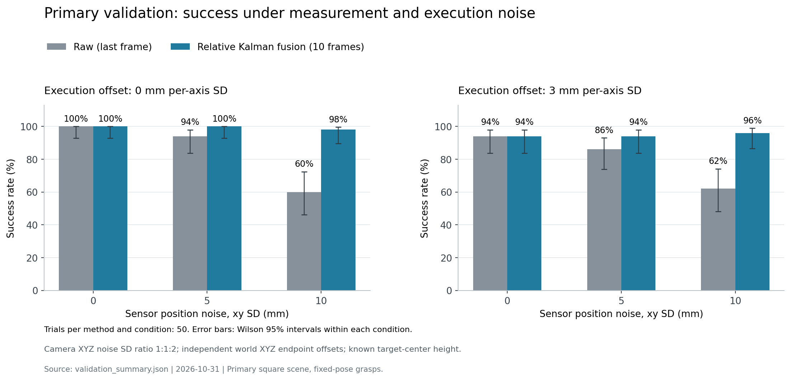

# RGB-D 机械臂抓取与相对位置卡尔曼融合

用 MuJoCo 和 Franka FR3 做桌面抓取，研究视觉定位误差如何影响抓取结果。
目标位置来自 RGB-D 图像；先把相机测点与测量协方差变换到世界坐标，再融合多帧观测，
将估计位置送入抓取规划和执行。仿真物体真值只用于结果评价。

## 抓取演示

[](docs/videos/fr3_grasp_demo.mp4)

[观看或下载 MP4](docs/videos/fr3_grasp_demo.mp4)：10 秒视频，动作部分以 0.5 倍速播放，
展示靠近、下降、夹紧、抬升和保持，右上角为夹爪特写。
本次演示使用 RGB-D 定位和相对位置卡尔曼融合，物体抬升约 11.2 cm，保持约 1.25 s，抓取判定通过。

## 验证结果概览



本次验证使用 110 个新随机种子，完成 1,080 次抓取，即 540 组配对比较。
每组使用相同的视觉观测和运动偏移样本：

- `raw`：直接使用末帧视觉位置，成功 **372/540（68.9%）**。
- `relative_kalman`：融合 10 帧相对位置观测，成功 **438/540（81.1%）**。
- 成功率增加 **12.2 个百分点**；按种子成组重采样得到的 95% 区间为 **8.3～16.3 个百分点**。
- 最终位置 RMSE 从 **12.45 mm** 降到 **8.61 mm**，降低 **30.8%**。

这里的对照是“末帧观测”和“多帧卡尔曼融合”。这批结果没有证明该方案优于其他 KF、
EMA 或简单平均。在目标静止、观测独立且同方差的条件下，本实现的融合结果等价于多帧平均。

## 仿真与抓取流程



RGB-D 图像 → 颜色区域 → 相机坐标测点与世界坐标点云 → 目标中心与平面几何 →
位置融合 → 抓取候选 → IK 与路径采样检查 → 关节轨迹、闭合夹爪、抬升 → 独立评估。

当前目标是尺寸已知、静止放在水平桌面上的规则物体。视觉前端使用 HSV 颜色阈值；
平面几何由目标顶面点估计，长方体主方向使用二维 PCA，近似方形采用对称退化处理。
抓取规划生成候选后检查可达性和采样路径的接触情况，再执行关节轨迹。

## 方法

### 从相机测点得到抓取目标

相机反投影得到三维点 $p_C$，使用已知外参转换到世界坐标：

$$
 p_W = R_{WC}p_C+t_{WC}.
$$

相机可见顶面点与物体中心不同。当前版本用公开的桌面高度和已知物体高度约束中心 Z，
X、Y 来自视觉测点。相机测点和位姿误差通过各自的雅可比传播到目标位置协方差：

$$
 R_z=J_s\Sigma_sJ_s^{\mathsf T}
       +J_{pose}\Sigma_{pose}J_{pose}^{\mathsf T}.
$$

固定中心高度时，位置变换的雅可比也同步约束 Z，避免把相机深度方差直接赋给已知中心高度。
本次仿真假设固定相机外参准确，因此位姿协方差项为零。
实现见 [relative_grasp_estimator.py](src/relative_grasp_estimator.py) 的
`target_measurement_from_camera()`。

### 相对位置融合

状态为按世界坐标轴表达的目标减夹爪向量 $r=p_{target}-p_{gripper}$。
预测和测量更新使用标准卡尔曼形式：

$$
\hat r^-_k=\hat r_{k-1}-\Delta p_{gripper},\qquad P^-_k=P_{k-1}+Q_k,
$$

$$
 z_k=p_{target,sensor}-p_{gripper},\qquad
 K_k=P^-_k(P^-_k+R_k)^{-1},
$$

$$
 \hat r_k=\hat r^-_k+K_k(z_k-\hat r^-_k).
$$

代码通过解线性方程计算增益，协方差更新采用 Joseph 形式。
第一帧的均值与协方差用于初始化，从第二帧开始更新，避免重复使用第一帧。
滤波后的相对向量加回当前夹爪位置，得到规划器需要的目标世界坐标。

`predict()` 支持在一段运动后加入过程协方差。本次批量实验是在机械臂静止时采集 10 帧，
因此这些帧之间的 $Q=0$。观测结束后，独立的执行偏移协方差只在执行边界加入一次。
后续没有视觉更新，不能将本次结果解释为“运动途中已经观测并纠正了机械臂偏移”。

## 实验结果



- 主验证：方块、固定抓取姿态，50 个种子；每种方法 300 次，**82.7% → 97.0%**。
- 方块几何抓取：20 个种子；每种方法 80 次，**75.0% → 90.0%**。
- 旋转长方体：20 个种子；每种方法 80 次，**80.0% → 93.75%**。
- 带绿色干扰物的组合场景：20 个种子；每种方法 80 次，**0/80 → 0/80**。
  检测、几何估计和动作执行有效，但没有达到抬升要求，根因仍需排查。



主验证中的每个噪声条件各有 50 组配对试次。
传感器位置噪声 XY 标准差为 0、5、10 mm，相机 XYZ 标准差比例为 1:1:2；
末端执行目标偏移的每轴标准差为 0 或 3 mm。3 mm 表示标准差，不是偏移上限。
在 **10 mm 传感器噪声＋3 mm 执行偏移** 条件下，成功次数为 **31/50 → 48/50**。
图中的误差条为各条件内的 Wilson 95% 区间。

噪声在视觉得到的三维目标测点上加入，没有对整幅 RGB 图像和深度图加入噪声。
物体尺寸和方向仍由原始 RGB-D 几何估计。运动误差用一次动作的执行目标终点偏移近似，
两种方法共享同一个偏移样本；它不是对整段轨迹施加随机力或关节扰动。

成功判定包括至少抬升 8 cm、保持 1 s，以及掉落、相对滑移、夹爪接触和禁止碰撞检查，
阈值见 [grasp_evaluation.json](config/grasp_evaluation.json)。

汇总统计中的同一种子在多个噪声条件下重复使用，成功率差的区间按种子成组计算，
而不是把所有抓取都视为独立样本。定位 RMSE 使用每种方法 270 个去重后的最终位置估计，
去除了相同视觉序列在不同运动偏移条件下的重复记录。

数据见 [完整汇总](results/large_validation/validation_summary.json) 和
[固定验证方案与源码指纹](results/large_validation/protocol/validation_plan.json)。
每组实验目录保存 `summary.json` 和完整的 `trials.json.gz`，后者包括逐次结果及逐帧滤波矩阵。
发布时只将本机路径改成相对路径，试次数据保持原值。

## 安装与运行

已验证环境：Windows、Python 3.11.18、MuJoCo 3.3.7、NumPy 1.26.4。
其余依赖见 [requirements.txt](requirements.txt)。仿真和状态估计使用 CPU；
相机渲染需要可用的 OpenGL 图形环境。

下面命令在 Windows PowerShell 的项目根目录执行。

### 获取代码和模型

```powershell
git clone https://github.com/z2653666716-dot/-RGB-D-.git rgbd-grasping
cd rgbd-grasping

# 只检出所需模型目录，固定到本次实验使用的上游提交。
git clone --filter=blob:none --no-checkout https://github.com/google-deepmind/mujoco_menagerie.git assets/third_party/mujoco_menagerie
git -C assets/third_party/mujoco_menagerie sparse-checkout init --cone
git -C assets/third_party/mujoco_menagerie sparse-checkout set franka_fr3 franka_emika_panda
git -C assets/third_party/mujoco_menagerie checkout a662de603224c47123b0783821c58ad4402ad3e3
```

FR3 机械臂和 Panda 两指夹爪来自 MuJoCo Menagerie，在仿真中通过法兰挂点装配。
模型采用 Apache-2.0 许可，保留各模型目录的 LICENSE 和原始文件。
来源与装配说明见 [UPSTREAM_SOURCES.md](assets/third_party/UPSTREAM_SOURCES.md)。
模型缓存由 `.gitignore` 排除，不随本仓库重复提交。

### 创建环境并检查场景

```powershell
conda env create --prefix .\robot_env --file environment.yml

# 检查关节、物体稳定性、相机和复现性；保存场景图与 JSON 报告。
.\robot_env\python.exe src\main.py

# 打开仿真窗口，关闭窗口后结束。
.\robot_env\python.exe src\main.py --gui
```

### 小范围实验

```powershell
.\robot_env\python.exe scripts\run_experiments.py --config config\relative_kalman_smoke.json
```

该配置运行 10 个开发种子、两档传感器噪声、两档执行偏移和两种方法，共 80 次抓取。
输出保存在 `outputs/large_validation/`，与仓库附带的历史结果分开。
开发种子不计入上述 1,080 次扩大验证。

### 重跑扩大验证

```powershell
foreach ($experimentName in @("primary", "square", "rectangle", "distractor")) {
    .\robot_env\python.exe scripts\run_experiments.py --config "config\relative_kalman_large_$experimentName.json"
    if ($LASTEXITCODE -ne 0) { throw "Experiment failed: $experimentName" }
}
```

四份配置合计 1,080 次抓取，分别使用 3000～3049、4000～4019、4100～4119、4200～4219 的种子。
每次试验的结果会立即写入 `trial_checkpoints.jsonl`；整个批次完成后另存 JSON、CSV 和汇总。

### 重绘仓库附带结果

```powershell
.\robot_env\python.exe scripts\plot_validation.py --summary results\large_validation\validation_summary.json --output docs\figures
```

该命令读取已归档汇总，生成 PNG、SVG 和数据指纹清单，不重新运行仿真。
新实验的原始输出位于 `outputs/`；调整实验参数后，需要按同样的统计口径重新汇总，再用于绘图。

用 Python 读取完整的压缩报告：

```python
import gzip
import json

path = "results/large_validation/relative_kalman_large_primary/trials.json.gz"
with gzip.open(path, "rt", encoding="utf-8") as file:
    report = json.load(file)
print(report["trial_count"])  # 600：包含两种方法的抓取次数
```

## 代码入口

```text
src/
  main.py                      场景检查与窗口入口
  simulation.py                FR3、夹爪、桌面和目标物体
  camera.py                    RGB-D 成像、相机内外参与坐标变换
  vision.py                    颜色区域与三维位置观测
  point_cloud.py               深度转点云，提供裁剪、体素和邻域处理
  geometry.py                  顶面中心、尺寸和主方向估计
  relative_grasp_estimator.py   协方差传播、相对位置卡尔曼融合
  state_estimator.py           原始观测、EMA 和常速度 KF
  grasp_planner.py             几何抓取候选
  grasp_filter.py              IK 与路径采样筛选
  inverse_kinematics.py         末端位姿到关节角
  grasp_controller.py          关节轨迹、开合夹爪和抬升
  evaluation.py                只在评估侧读取真值并判定结果
scripts/
  run_experiments.py            配对实验入口
  plot_validation.py            从已有汇总生成图表
config/                        场景、滤波、抓取与实验参数
results/large_validation/       本次归档结果
assets/third_party/             模型来源；模型文件按固定版本另行获取
docs/figures/                  场景图、对比图及 SVG
```

阅读顺序建议为 `scripts/run_experiments.py` → `vision.py`、`camera.py` →
`relative_grasp_estimator.py` → 抓取规划、控制和评估模块。
`state_estimator.py` 中保留了其他估计器实现，本次图表仅使用 `raw` 和 `relative_kalman` 的结果。

可调整参数集中在配置中：`test_seeds` 控制样本数；`observation_frame_count` 控制观测帧数；
`position_noise_levels_m` 和 `motion_position_offset_levels_m` 控制两类扰动的标准差；
`minimum_sensor_position_std_m` 是滤波器采用的测量标准差下限，不会额外生成实际噪声。
新参数实验应使用新的输出目录，并同时对两种方法生效。

## 当前限制

- 固定相机、水平桌面、静止规则物体；相机外参和物体高度视为已知。
- 颜色分割仍依赖目标外观。SAM 自动分割是后续可选方案，当前没有接入。
- KF 协方差描述假定的随机误差，不能消除固定的检测偏差。
- 执行终点偏移是简化模型，尚未验证运动中的视觉纠偏或真实机械臂部署。
- 带干扰物的组合场景仍未抓取成功，不能将其他场景的提升直接推广到它。
